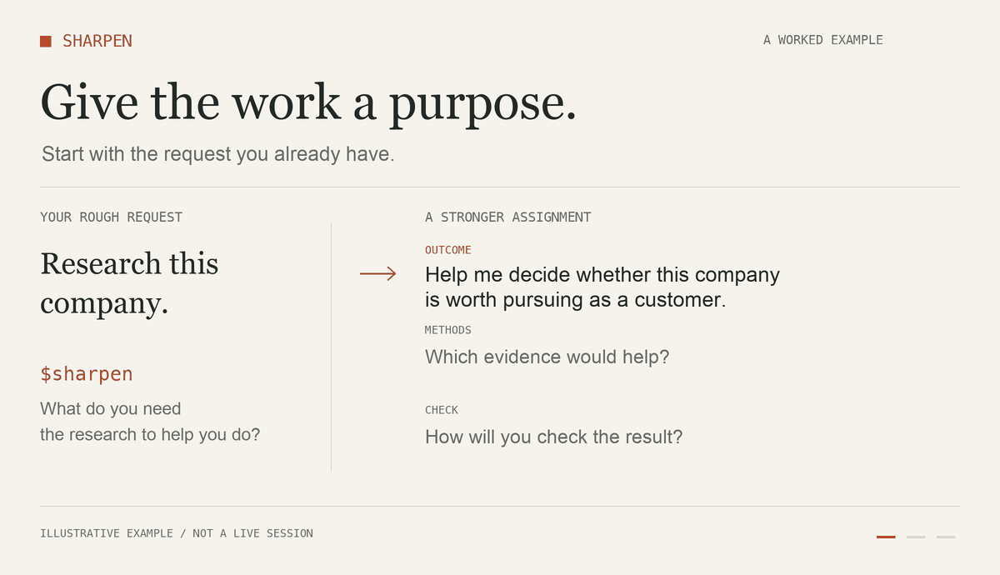

# Sharpen

**Turn a rough request into a stronger assignment.**

A small AI agent skill for thinking through what you want, choosing useful methods, and checking the result. Start with whatever you would normally type. Sharpen helps turn it into work with a clear purpose.



[Quick start](#quick-start) · [The takeaways](#the-takeaways) · [Examples](#examples) · [How to use it well](#how-to-use-it-well) · [Still image](assets/sharpen-demo.png)

## About

I made Sharpen after reading Felix Rieseberg’s [How to be more ambitious: A tutorial for humans with models](https://felixrieseberg.com/how-to-be-more-ambitious-a-tutorial-for-humans-with-models/). I wanted a skill I could type before a rough request to help me think through the assignment.

“Research this company” leaves a lot undecided. Are you preparing for an interview, deciding whether to buy its product, or looking for a customer? Each purpose calls for different evidence and a different output. Sharpen helps surface those choices before you spend time correcting the work.

The aim is practical: less explaining, fewer corrections, and results you can use. The skill uses relevant context already available, asks when your answer would materially change the assignment, and keeps simple requests simple.

## Quick start

### 1. Install in Codex

With Git installed, run this in your terminal to add Sharpen to your personal skills folder:

```sh
mkdir -p ~/.agents/skills
git clone https://github.com/MSizzle/sharpen.git ~/.agents/skills/sharpen
```

If Sharpen is already installed, review or back it up before replacing it. The clone command refuses to overwrite a nonempty folder. Codex should detect the skill automatically; restart it if Sharpen does not appear. See the [official skills documentation](https://learn.chatgpt.com/docs/build-skills) for local discovery and installation details.

### 2. Give it a real request

```text
$sharpen Prepare me for a meeting with a potential customer tomorrow.
I want to understand their business and decide what to ask.
```

Sharpen explains the main improvement and gives you a prompt to copy and use. You can add constraints or correct an assumption before starting the work.

### 3. Add “and do it” when you want the work done

```text
$sharpen and do it: Prepare me for a meeting with a potential customer
tomorrow. Use the notes in this project. Give me a short brief and
questions that help me understand whether we can help them.
```

This mode improves the approach and carries out the authorized task in the same conversation. It only uses information and tools your agent can actually access.

**Using another assistant?** The workflow lives in [SKILL.md](SKILL.md). Use it as instructions and adapt the invocation to your host. Sharpen has no required API keys, services, or runtime dependencies of its own. Your assistant supplies the model and any tools needed for the underlying work.

## The takeaways

These are the habits Sharpen is designed to make repeatable. You can use them when writing a prompt yourself, too.

| Habit | What to ask yourself | What changes in the assignment |
| --- | --- | --- |
| **Start with the outcome.** | What should I be able to decide or do afterward? | “Make a deck” becomes a brief that helps a team make a specific decision. |
| **Go deeper into the methods.** | What original evidence and tools would a strong practitioner use? | The work names sources, checks assumptions, and uses methods suited to the question. |
| **Borrow a useful method.** | Would a technique from another field help? | A proposal might benefit from a buyer’s evaluation criteria or a pre-mortem of how the plan could fail. |
| **Give the work a check.** | What evidence would show that the result holds up? | Claims have sources, a recommendation has supporting evidence, or a change passes a relevant test. |

Use the habits that earn their added effort. A small edit can remain a small edit. Ambitious requests still need honest feasibility checks and explicit uncertainty.

## Examples

### Research with a purpose

**Rough request**

```text
$sharpen Research this prospect.
```

**A stronger assignment might be**

> Help me decide whether this company is worth pursuing for our consultancy. Use available evidence about its operations to identify a plausible problem we could solve. Separate facts from hypotheses, explain what remains unknown, and recommend the next step. If the evidence is weak, say so.

The useful change is a decision to support, a reason to gather evidence, and a stopping point.

### A brief people can act on

```text
$sharpen Help me write a proposal. The reader is the operations lead.
They need to decide whether to fund a pilot. Keep it to two pages.
```

Sharpen can help identify the evidence, scope, tradeoffs, and success checks the reader needs to make that decision.

### Correct an unhelpful direction

```text
$sharpen our approach: This report lists facts, but I still cannot
decide what to do. I need to choose between the two options this week.
```

Sharpen diagnoses the missing decision criteria or evidence and proposes a concrete correction. Execution continues when the conversation already authorizes it.

These are illustrative examples, not benchmark results or guaranteed outputs.

## Choose the mode

| Say this | Get this |
| --- | --- |
| `$sharpen [request]` | A clearer assignment and a copy-ready prompt. |
| `$sharpen and do it: [request]` | An improved approach followed by the authorized work. |
| `$sharpen our approach: [context]` | A diagnosis and correction when the current work is unhelpful. |

A task described inside a prompt being refined stays draft material. Earlier execution authorization still applies; new material expansions or consequential actions need authorization.

## How to use it well

- **Give it the messy version.** A few sentences about what you need are enough to start.
- **Name the decision or audience when you know it.** “For my sales call” gives the research a purpose.
- **Point to relevant context.** Name the notes, files, or earlier work the agent should use.
- **Keep real constraints.** Include your deadline, budget, format, and anything the work must preserve.
- **Use it where the approach matters.** Research, proposals, project planning, and stuck work are good starting points. Routine edits may not need it.

### How to tell whether it helped

After a real assignment, check whether you could use the result, whether important claims had evidence, and how much correcting you had to do. A longer prompt by itself tells you very little. If Sharpen adds questions or process without improving the work, simplify the assignment or report the failure.

## Inspiration and credit

Felix Rieseberg’s article supplied the starting point: reconsider the outcome, go deeper into professional methods and source material, and draw useful techniques from other fields. Sharpen turns those ideas into a reusable workflow with refinement and execution modes, selective questions, and observable checks.

Created by [Monty Singer](https://github.com/MSizzle). This is an independent implementation. The linked article remains Felix’s work; no endorsement is implied.

## Contribute

[Open an issue](https://github.com/MSizzle/sharpen/issues) with a real example: the rough request, what went wrong, and what a useful result would have looked like. Remove private information before sharing. Improvements should make the skill easier to use or improve the resulting work.

The instructions are in [SKILL.md](SKILL.md), with Codex display metadata in [agents/openai.yaml](agents/openai.yaml). The illustrated demo is built from [scripts/render_demo.py](scripts/render_demo.py); its captions are also covered in the examples above.

[MIT licensed](LICENSE). The license covers this repository’s original material, including its demo assets, and does not cover the linked article.
