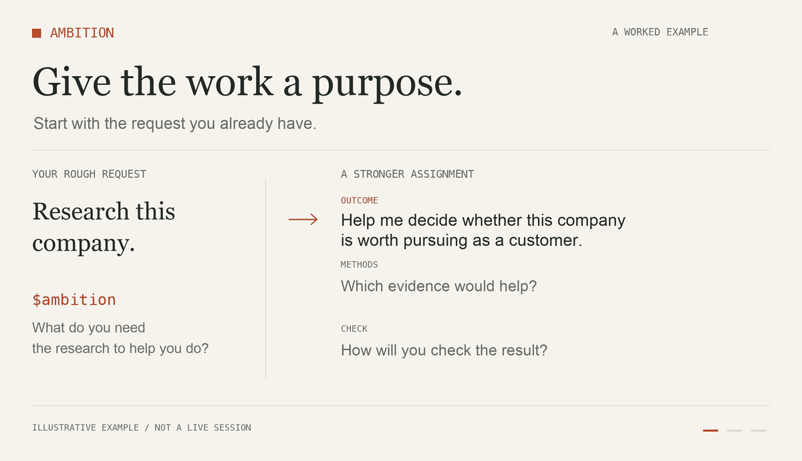

# Ambition

**Turn a rough request into work worth doing.**

Ambition is an AI agent skill that helps you choose a better approach, make the assignment concrete, and check whether the result holds up. Bring the messy version. You do not need to know which methods an expert would use.

```text
$ambition Help me prepare a proposal for a customer.
They need to decide whether to fund a pilot. Keep it to two pages.
```

You get a brief explanation of the useful improvement and one prompt you can copy. Add **“and do it”** to have your assistant carry out the improved assignment.



[Install](#install) · [Use it](#use-it) · [How it works](#how-it-works) · [With other skills](#with-other-skills) · [Examples](#examples)

## Install

### Codex

With Git installed, run:

```sh
mkdir -p ~/.agents/skills
git clone https://github.com/MontySinger/ambition.git ~/.agents/skills/ambition
```

The clone command refuses to overwrite a nonempty folder. If you already have a local version, review or back it up before replacing it. Codex detects installed skills automatically; restart if Ambition does not appear. See the [official skills documentation](https://learn.chatgpt.com/docs/build-skills).

If you installed by cloning and have no local edits, update with:

```sh
git -C ~/.agents/skills/ambition pull --ff-only
```

### Other assistants

The workflow is in [SKILL.md](SKILL.md). Install it using your assistant's skill mechanism, or provide that file as instructions with your request. Invocation syntax and skill support depend on the host.

Ambition has no required API keys, services, or runtime dependencies. Your assistant provides the model, available tools, and access to your material. It can help frame a task without those tools, but executing and verifying the work may require them.

## Use it

| What you want | What to type | What happens |
| --- | --- | --- |
| A better assignment | `$ambition [your request]` | A brief explanation and a copy-ready prompt. |
| The work completed | `$ambition and do it: [your request]` | An improved approach, execution, and a report of what was checked. |
| Help with unhelpful work | `$ambition our approach: [what is wrong]` | A diagnosis and concrete correction, applied when execution is already authorized. |

You can express the same intent in ordinary language. Mention useful files, the audience, and any constraints you already know. There is no form to fill out. Ambition asks a focused question when a consequential choice cannot be resolved from context.

For a quick task, say so:

```text
$ambition and do it: Tighten this paragraph. Keep my voice and meaning.
Spend no more than a few minutes on it.
```

For work where you want a bigger rethink:

```text
$ambition We prepare the same support report every week, but nobody
uses it. Help us decide how to make it useful. We can change the
process, but we only have an afternoon to try something.
```

Ambition can recommend a different deliverable or a repeatable workflow. It asks before adopting a material expansion and does not create a recurring job merely because one might help.

## How it works

Inspired by Felix Rieseberg's [How to be more ambitious: A tutorial for humans with models](https://felixrieseberg.com/how-to-be-more-ambitious-a-tutorial-for-humans-with-models/).

The article describes **Speed, Altitude, Depth, and Range**. Ambition uses those directions selectively:

| Direction | Practical question |
| --- | --- |
| **Speed** | Is this already a good task that simply needs doing efficiently? |
| **Altitude** | What result should this task enable, and is there a better way to reach it? |
| **Depth** | Which primary evidence, concrete methods, and assumption checks would improve the work? |
| **Range** | Would a technique from another discipline contribute something useful? |

Ambition turns the selected approach into a small working brief: **outcome and constraints → inputs and method → deliverable → check**. You see the useful result, without a mandatory report on every direction.

It also considers worthwhile stretch objectives. A stretch objective is something to investigate against real constraints and a baseline, not a promise that persistence will make anything possible.

Verification is part of the assignment. Depending on the work, that could mean a working test, a measurement, source evidence, evaluation on separate data, or feedback from the intended audience. A model approving its own answer does not establish that it is right.

## With other skills

Tell Ambition which skill or workflow you want to use. It should improve the brief and carry your requirements into that specialist's workflow.

For example, if your assistant has a slide-making skill:

```text
$ambition and do it: Use my slide-making skill and the attached brand
template to prepare a six-slide product review. Leadership needs to
choose which customer problem to prioritize. Use the interview notes
in this project and show the evidence behind the recommendation.
```

Use the specialist's actual name or invocation if your host requires one. Ambition preserves its relevant instructions, the template, and the requested output. In refinement mode it includes the specialist in the new prompt; in execution mode it uses the specialist to do the work.

It does not install missing skills or claim that unavailable tools were used. If something essential is missing, it identifies the gap and offers a useful next step.

## Examples

### Improve the analysis behind a recommendation

**Your request**

```text
$ambition Explain why our customers cancel. We think the problem is
our welcome emails. We have signup dates, cancellation dates, product
activity, and the emails each customer received. We need to choose
what to investigate next.
```

**A possible improvement**

Test the welcome-email explanation against the available records before recommending a change.

**A possible copy-ready prompt**

```text
Help us decide what to investigate next about customer cancellations.
Use the supplied signup dates, cancellation dates, product activity,
and email records. Check data completeness and define the comparison
before analyzing it. Compare customers with comparable time to cancel,
look for evidence for and against our welcome-email explanation, and
consider alternative explanations supported by the records.

Return a concise recommendation with the supporting calculations,
limitations, and a practical follow-up check. Do not treat an
observational association as proof that the emails cause cancellations.
```

This example assumes the stated records will be supplied to the assistant. It does not imply the data has been analyzed.

### Borrow a method that fits

```text
$ambition Improve our handover checklist. It is accurate, but people
skip steps when the shift is busy. Keep it to one page.
```

A useful direction might be to apply human-factors methods: identify where steps are missed, place prompts at the moment of action, and try the revised checklist during a realistic handover. The contribution is a concrete method with a check.

### Keep the creative goal

```text
$ambition Help me write a strange, funny poem about a moth running
a lighthouse. It is a birthday gift, and I want it to sound like me.
```

The poem itself can be the goal. A useful refinement might preserve the recipient's sense of humor and the writer's voice. It should not turn the gift into a marketing exercise.

### Correct course

```text
$ambition our approach: This report lists facts, but I still cannot
choose between the two suppliers. The deadline is Friday, and the
contract requirements are already in this project.
```

A useful correction is to connect the existing evidence to the requirements, identify what could change the choice, and resolve the consequential gap. It should reuse the work already done.

These examples illustrate intended behavior; they are not benchmark results or guaranteed outputs.

## What good looks like

You should be able to explain what improved, use the resulting prompt or deliverable, and see what supports the conclusion. A clear request should stay short. A complex request should gain useful methods, evidence, or a better approach.

Ambition cannot supply missing data, guarantee discoveries, or make an unavailable tool work. Results depend on the assistant and its environment. The [evaluation scenarios](evals/scenarios.md) provide concrete cases for checking behavior when the skill changes.

## Credit and contributions

Created by [Monty Singer](https://github.com/MontySinger), inspired by Felix Rieseberg's article. This is an independent implementation; no endorsement is implied. The execution modes, skill handoff, and working-brief format are implementation choices.

[Open an issue](https://github.com/MontySinger/ambition/issues) with the request, what happened, and what would have made the result useful. Include the assistant and relevant skills, and remove private information before sharing.

Instructions live in [SKILL.md](SKILL.md), with Codex display metadata in [agents/openai.yaml](agents/openai.yaml). The [demo source](scripts/render_demo.py) generates the illustration; its optional Pillow dependency is only needed to rebuild the images. [View the still image](assets/ambition-demo.png).

[MIT licensed](LICENSE). The license covers this repository's original material, including its demo assets, and does not cover the linked article.
